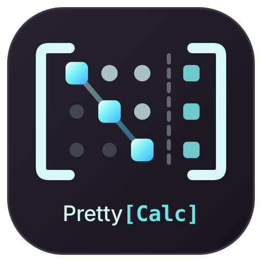

<p align="center">
  
</p>

<h1 align="center">PrettyCalc</h1>

<p align="center">
  Calculadora de escritorio de álgebra lineal que muestra cada procedimiento paso a paso, con aritmética exacta.
</p>

<p align="center">
  <a href="https://github.com/robertofabiot/PrettyCalc/actions/workflows/tests.yml"></a>
  
  
  <a href="LICENSE"></a>
</p>

---

## Descripción

PrettyCalc es una aplicación de escritorio en PySide6 para estudiantes de álgebra lineal que necesitan ver *cómo* se llega al resultado, no solo el resultado. Cada cálculo llena un carrusel con sus pasos: la matriz de ese momento, la operación en notación de libro (F₂ → F₂ − 3F₁, A⁻¹, ‖v‖²) y una explicación en lenguaje natural, con el pivote y las filas involucradas resaltados.

El motor matemático (`prettycalc.core`) trabaja con `fractions.Fraction` y no depende de NumPy, SciPy ni SymPy: no hay redondeos y el mismo código se prueba y se reutiliza sin la interfaz. Nació como proyecto del curso Álgebra Lineal (MTM0120) de la Universidad Americana (UAM).

## Módulos

| Módulo | Atajo | Qué resuelve |
| --- | --- | --- |
| Sistemas lineales | Ctrl+1 | Gauss-Jordan sobre [A \| b], clasificación (SCD, SCI, SI), forma vectorial paramétrica, Regla de Cramer y aplicaciones: balanceo químico, Leontief, dieta y flujo en redes. |
| Álgebra matricial | Ctrl+2 | A ± B, k·A, A·B con inspector celda a celda, Aᵀ, A⁻¹ por Gauss-Jordan, propiedades distributivas y asociativas, Teorema de la Matriz Invertible e identidades de la inversa. |
| Vectores en ℝⁿ | Ctrl+3 | u ± v, k·v, norma exacta (con radical simplificado), distancia, producto exterior, combinación lineal e independencia lineal. |
| Ecuaciones matriciales | Ctrl+4 | A x = b con comprobación componente a componente y propiedades de A·x. |
| Determinantes | Ctrl+5 | Triangulación, Sarrus, cofactores de Laplace por cualquier fila o columna, matriz adjunta, inversa analítica y propiedades del determinante. |
| Factorización LU | Ctrl+6 | PA = LU con permutación cuando hace falta, y Ly = Pb, Ux = y reutilizando los factores. |
| Transformaciones lineales | Ctrl+7 | T(v) = A·v, núcleo, imagen, rango, nulidad y Teorema de la Dimensión. |
| Espacios vectoriales | Ctrl+8 | Conjuntos generadores de ℝᵐ, y base y dimensión de Ker A. |

## Arquitectura

```
prettycalc.ui  (PySide6, vistas y componentes)  ──►  prettycalc.core  (Fraction, sin dependencias)
   carrusel de pasos · cuadrículas · tablero        cálculo + StepTracer: cada operación
   de resultados · barra lateral · temas            registra la matriz y su explicación
```

El núcleo no importa Qt. Cada cálculo devuelve su resultado y un `StepTracer` con los pasos; la interfaz solo los muestra.

| Paquete | Responsabilidad |
| --- | --- |
| `core.types` | `Matrix`, `Vector`, lectura y formato de escalares exactos (enteros, fracciones, decimales). |
| `core.elimination`, `classifier`, `verifier` | Gauss y Gauss-Jordan, clasificación de Rouché-Frobenius y comprobación por sustitución. |
| `core.determinants`, `adjugate`, `cramer` | Determinantes por cada método, adjunta e inversa analítica, Regla de Cramer. |
| `core.matrix_ops`, `matrix_inversion`, `matrix_properties`, `theorems` | Operaciones matriciales con su trazado, inversa, propiedades y TMI. |
| `core.lu_decomposition` | Factorización LU / PLU y las dos sustituciones. |
| `core.vector_ops`, `linear_combination`, `linear_independence` | Operaciones y métricas de vectores, combinación e independencia lineal. |
| `core.linear_transformations`, `vector_spaces`, `basis_steps` | Núcleo, imagen, conjuntos generadores, bases y los pasos que se leen de la RREF. |
| `core.applied_models` | Aplicaciones de la sesión 8 (química, Leontief, dieta, tráfico). |
| `core.tracer` | Registro de pasos: matriz, fórmula, explicación, pivote y celdas resaltadas. |
| `ui.modules` | Una vista por módulo. |
| `ui.stepper_carousel`, `matrix_grid`, `results_dashboard`, `navigation_bar` | Carrusel de pasos, cuadrícula editable, tablero de resultados y barra lateral. |
| `ui.theme`, `platform_setup` | Paleta, hojas de estilo, fuentes empaquetadas y ajustes por plataforma. |

El detalle está en [Arquitectura del sistema](Docs/architecture.md).

## Características técnicas

- **Paso a paso en todo:** ningún procedimiento muestra un resultado intermedio sin su desarrollo. Hasta 3×3 cada determinante lleva su cuenta completa (ad − bc o Sarrus); desde 4×4, todos los pasos de su triangulación. Eso incluye los menores de Laplace y de la adjunta, Cramer y las propiedades del determinante.
- **Aritmética exacta:** todo se calcula con `Fraction`. El interruptor Fracciones / Decimales solo cambia cómo se muestra.
- **Notación de libro:** las fórmulas de los pasos se convierten de LaTeX a HTML (subíndices, exponentes, fracciones) en lugar de mostrar código. El contrato está en la [especificación de renderizado](Docs/latex-rendering-spec.md).
- **Entrada sin fricción:** las cuadrículas crecen con celdas fantasma `+`, aceptan enteros, fracciones (`3/4`) y decimales, y explican en línea cada error («A, fila 2, columna 3: divide entre cero»). Pegar, reiniciar o cargar un ejemplo se puede deshacer.
- **Exportación del procedimiento:** PDF, HTML, LaTeX o texto, desde el carrusel.
- **Interfaz adaptable:** de 1080 × 680 a 1920 px sin desplazamiento horizontal. La barra lateral se pliega a un riel en portátiles y las vistas de tres columnas bajan los resultados cuando no caben.
- **Accesibilidad:** temas oscuro, claro y de alto contraste con contraste WCAG AA, escala de la interfaz y navegación completa por teclado.
- **Misma apariencia en Windows y Linux:** estilo Fusion, fuentes empaquetadas (Inter, Fira Code y DejaVu Sans), tamaños en píxeles y, en Windows, rasterizado con FreeType, barra de título oscura e icono propio en la barra de tareas.

## Integración continua

| Flujo | Función |
| --- | --- |
| `tests.yml` | En cada push y PR corre la suite completa en Ubuntu y Windows, con Python 3.10 y 3.13. |

Las pruebas de `tests/ui/test_cross_platform.py` comprueban que la geometría de la ventana es idéntica con 96 y 144 ppp y sin ninguna fuente del sistema. `tests/ui/test_responsive_layout.py` recorre los ocho módulos con sus ejemplos cargados y exige que ninguno se desplace en horizontal.

## Ejecución local

Requisitos: Python 3.10 o superior y un entorno gráfico de escritorio.

```bash
git clone https://github.com/robertofabiot/PrettyCalc.git
cd PrettyCalc
python3 -m venv .venv
source .venv/bin/activate          # Windows: .venv\Scripts\activate
pip install -r requirements.txt
pip install -e .
python run.py                      # o, tras la instalación, simplemente: prettycalc
```

`requirements.txt` instala PySide6 y las herramientas de prueba. Con Python 3.10 y 3.11 se excluye PySide6 6.12.0, que en esas versiones aborta con `none_dealloc`.

**Atajos comunes** (F1 abre la hoja completa)

| Acción | Atajo |
| --- | --- |
| Calcular / resolver desde cualquier celda | Ctrl+Intro |
| Deshacer / rehacer un cambio de la cuadrícula | Ctrl+Z / Ctrl+Y |
| Eliminar la fila / la columna de la celda activa | Ctrl+Supr / Ctrl+Mayús+Supr |
| Copiar / pegar la matriz completa (TSV, Excel, LaTeX) | Ctrl+C / Ctrl+V |
| Ir a un módulo | Ctrl+1 … Ctrl+8 |
| Recorrer el procedimiento | ← / → (con el carrusel enfocado) |
| Apariencia: tema y escala | Ctrl+, |

## Uso del motor sin interfaz

```python
from prettycalc.core import Matrix, classify_system, gauss_jordan_elimination, matrix_determinant, DeterminantMethod

aumentada = Matrix([[1, 1, 1, 4], [2, -1, 1, 4], [1, 2, -1, 3]])
rref, tracer = gauss_jordan_elimination(aumentada, split_col=3)
print(classify_system(aumentada, split_col=3).unique_solution)   # [2, 1, 1] como Fraction

for paso in tracer:
    print(paso.step_number, paso.heuristic_text)

A = Matrix([[1, 3, -3], [2, 0, 1], [-1, 4, -2]])
laplace = matrix_determinant(A, DeterminantMethod.LAPLACE_ROW, expansion_index=1)
print(laplace.value)                                              # -19, con cada menor desarrollado en laplace.tracer
```

## Pruebas

```bash
pytest                              # con pantalla
QT_QPA_PLATFORM=offscreen pytest    # sin pantalla (CI, SSH)
```

## Documentación

| Documento | Contenido |
| --- | --- |
| [Definición del problema](Docs/problem-definition.md) | Qué resuelve PrettyCalc y para quién. |
| [Especificación matemática](Docs/mathematical-spec.md) | Algoritmos, invariantes y casos límite del motor. |
| [Arquitectura del sistema](Docs/architecture.md) | Capas, módulos y flujo de datos. |
| [Reglas de diseño](Docs/design-rules.md) | Paleta, tipografía, navegación y patrones de interacción. |
| [Renderizado de fórmulas](Docs/latex-rendering-spec.md) | Conversión de LaTeX a notación de libro. |
| [Estrategia de pruebas](Docs/testing-strategy.md) | Qué se prueba y cómo. |
| [Estándares de código](Docs/coding-standards.md) | Convenciones del proyecto. |
| [Hoja de ruta](Docs/roadmap.md) y [sprints](Docs/Sprints/README.md) | Planificación y registro de cada iteración. |

## Licencia

PrettyCalc se distribuye bajo la [licencia MIT](LICENSE).
