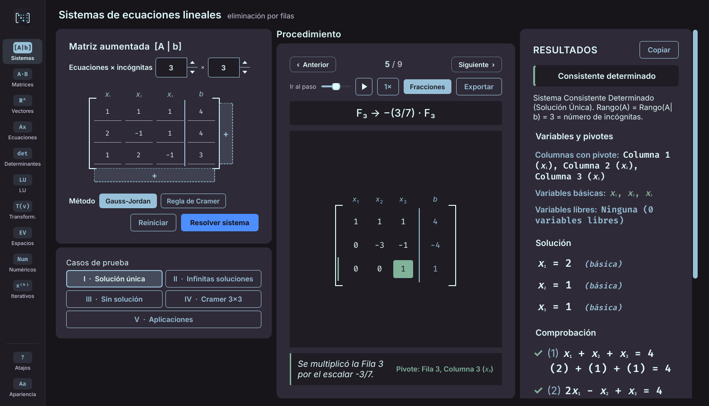
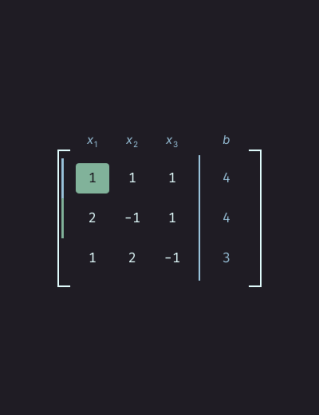
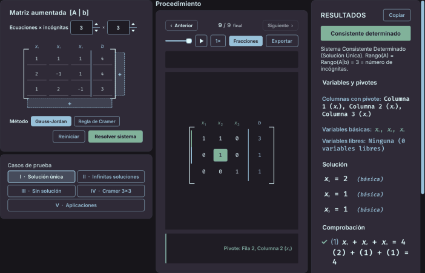
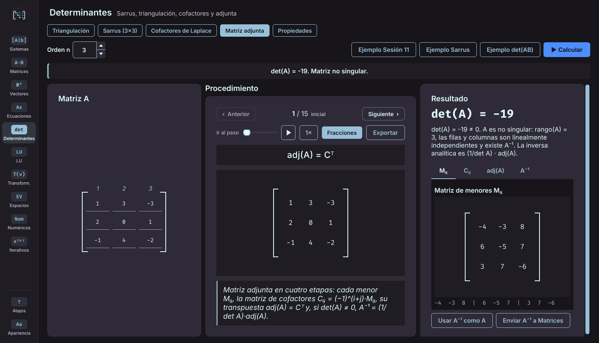
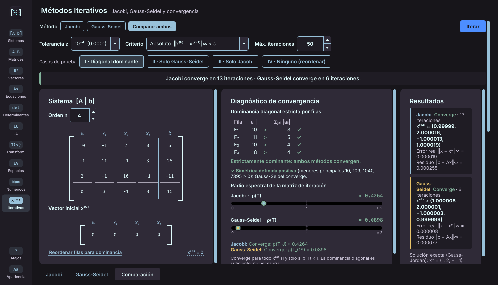

<p align="center">
  
</p>

<h1 align="center">PrettyCalc</h1>

<p align="center">
  <b>Álgebra lineal paso a paso, sin redondeos.</b><br>
  Una calculadora de escritorio que muestra <i>cómo</i> se llega al resultado, no solo el resultado.
</p>

<p align="center">
  <a href="https://github.com/robertofabiot/PrettyCalc/actions/workflows/tests.yml"></a>
  
  
  <a href="LICENSE"></a>
</p>

<br>

### Cada paso, explicado

Se escribe el sistema, se pulsa **Resolver** y el procedimiento aparece en un carrusel: la matriz de ese momento, la operación como en el cuaderno (F₃ → −(3/7)·F₃) y una frase que la explica, con el pivote resaltado. A la derecha queda la solución, comprobada ecuación por ecuación.

<p align="center">
  
</p>

### Las filas se mueven frente a ti

Al avanzar un paso, la fila pivote viaja hasta la fila que modifica y solo cambian las entradas que la operación tocó. El botón ▶ reproduce todo el procedimiento de corrido.

<p align="center">
  
  &nbsp;&nbsp;&nbsp;
  
</p>

### Fracciones exactas, siempre

Todo se calcula con fracciones, así que `1/3` nunca se redondea a `0.333…`; los decimales son solo una forma de mostrar el resultado. Un determinante sale por triangulación, Sarrus, cofactores de Laplace o la matriz adjunta, cada uno con su desarrollo completo.

<p align="center">
  
</p>

### ¿Converge o no?

Con Jacobi y Gauss-Seidel lado a lado se ve por qué un método converge antes que el otro: dominancia diagonal, radio espectral ρ(T) y el número de iteraciones de cada uno. Si ninguno converge, PrettyCalc propone reordenar las ecuaciones.

<p align="center">
  
</p>

### Y mucho más

Diez módulos en la barra lateral: **sistemas lineales**, **álgebra matricial**, **vectores**, **ecuaciones matriciales**, **determinantes**, **factorización LU**, **transformaciones lineales**, **espacios vectoriales**, **métodos numéricos** y **métodos iterativos**. Cada procedimiento se exporta a PDF, HTML, LaTeX o texto, hay temas oscuro, claro y de alto contraste, y todo se maneja con el teclado.

<br>

## Empezar

Requiere Python 3.10 o superior.

```bash
git clone https://github.com/robertofabiot/PrettyCalc.git
cd PrettyCalc
python3 -m venv .venv
source .venv/bin/activate        # Windows: .venv\Scripts\activate
pip install -r requirements.txt
pip install -e .
prettycalc
```

**Ctrl+Intro** calcula, **Ctrl+1 … Ctrl+0** cambia de módulo y **F1** muestra todos los atajos.

Para correr las pruebas: `pytest`.

## Más

La arquitectura, la especificación matemática y las reglas de diseño están en [`Docs/`](Docs/README.md).

<sub>Hecho para el curso de Álgebra Lineal (MTM0120) de la Universidad Americana (UAM) · <a href="LICENSE">Licencia MIT</a></sub>
